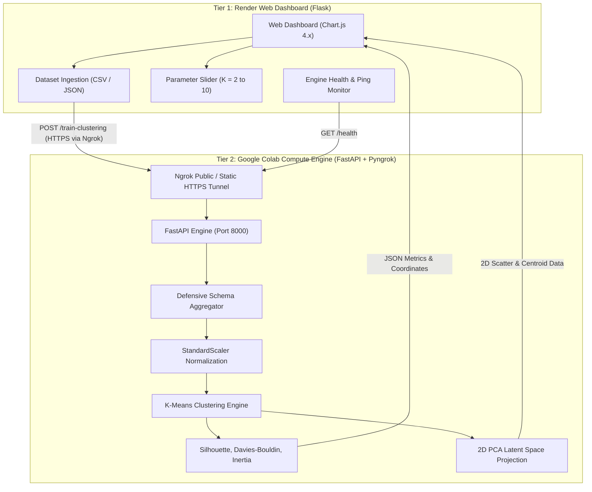

# City-Service Review Profiles for Business Pattern Segmentation Through Clustering

[](https://www.python.org/)
[](https://colab.research.google.com/)
[](https://render.com/)
[](https://fastapi.tiangolo.com/)
[](https://scikit-learn.org/)
[](https://www.chartjs.org/)
[](https://opensource.org/licenses/MIT)

---

## 📌 Project Overview

**City-Service Review Profiles for Business Pattern Segmentation** is a full-stack, distributed machine learning system designed to discover underlying operational archetypes across metropolitan businesses from customer reviews.

The system partitions intensive computational workloads (feature aggregation, standardisation, K-Means clustering, PCA dimensionality reduction, and metric calculations) onto a remote **Google Colab GPU/CPU Compute Engine** exposed via an authenticated **Ngrok tunnel**, while mentors and business analysts interact with a clean, responsive **Render Web Dashboard**.

---

## 🏛 System Architecture



---

## 🗂 Project Structure

```text
City Service pipeline/
├── app.py                       # Render Web Server & Colab proxy (with zero-downtime fallback)
├── colab_worker.py              # Google Colab ML Engine (FastAPI, Scikit-Learn, Pyngrok)
├── colab_notebook.ipynb         # Ready-to-run Google Colab Notebook
├── requirements.txt             # Render web server dependencies (Flask, Gunicorn, Scikit-Learn, etc.)
├── Procfile                     # Process manager file for Render web deployment
├── render.yaml                  # Render Blueprint specifying build/start commands & env vars
├── .gitignore                   # Excludes __pycache__, virtual environments, and temporary files
├── README.md                    # Project documentation and deployment guides
│
├── sample_data/                 # Verified sample datasets for instant testing
│   ├── generate_samples.py      # Script to generate synthetic reviews
│   ├── sample_reviews.csv       # 2,710 raw reviews across 100 businesses (Case A)
│   └── sample_aggregated.csv    # 100 pre-aggregated business profiles (Case B)
│
├── templates/
│   ├── index.html               # Responsive dashboard UI (HTML5, Tailwind CSS, Chart.js)
│   └── settings.html            # Dedicated Google Colab connection settings & diagnostics
│
├── static/
│   ├── css/styles.css           # Custom styling and glassmorphic controls
│   └── js/dashboard.js          # Real-time health check, AJAX training, Chart.js logic
│
└── test_app.py                  # Integration test suite for Flask routes and fallback engine
```

---

## 🚀 Setup & Execution Guide

### Step 1: Run Google Colab Compute Engine

1. Open [Google Colab](https://colab.research.google.com/) and upload `colab_notebook.ipynb` (or create a new notebook).
2. Install the required dependencies in a code cell:
   ```bash
   !pip install fastapi uvicorn pyngrok nest-asyncio scikit-learn pandas numpy python-multipart requests
   ```
3. Get a free Ngrok authtoken from [dashboard.ngrok.com](https://dashboard.ngrok.com/get-started/your-authtoken).
4. Run the Colab engine in a code cell:
   ```python
   # In Google Colab:
   from colab_worker import start_server

   start_server(
       ngrok_token="<YOUR_NGROK_AUTHTOKEN>",
       domain="doctrine-wages-hubcap.ngrok-free.dev", # Or omit for free dynamic tunnel
       port=8000
   )
   ```
5. When executed, Colab outputs your public HTTPS URL:
   ```text
   ======================================================================
   🚀 GOOGLE COLAB ML TRAINING ENGINE IS ONLINE!
   ======================================================================
   👉 PUBLIC URL TO ENTER IN RENDER DASHBOARD:
      https://xxxx-xx-xx-xx.ngrok-free.app
   👉 HEALTH PROBE: https://xxxx-xx-xx-xx.ngrok-free.app/health
   ======================================================================
   ```

---

### Step 2: Configure Render Web Dashboard

1. Open your live Render web application URL.
2. Click **Engine Settings** in the top navigation.
3. Paste the generated Ngrok HTTPS URL into the **Colab Worker Tunnel URL** field.
4. Click **Update & Ping** (or **Save Configuration**).
5. The status badge will glow green: **"Colab ML Engine: Online"**!

---

### Step 3: Run Clustering & View Visualizations

1. Select your target number of clusters $K$ using the slider ($K=2$ to $10$).
2. Upload a CSV/JSON dataset, or click **"Load Sample Reviews (Case A)"** to test immediately.
3. Click **Execute ML Pipeline**.
4. The dashboard will dynamically render:
   - **Evaluation Metrics:** Silhouette Score, Davies-Bouldin Index, Inertia (WCSS), and PCA 2D Explained Variance.
   - **Interactive 2D PCA Scatter Plot:** High-contrast color-coded clusters with interactive tooltips and toggleable centroid markers.
   - **Cluster Feature Profiles Bar Chart:** Comparative analysis of average rating, volatility, volume, and text length.
   - **Market Share Doughnut Chart:** Distribution of businesses across clusters.
   - **Business Pattern Archetype Matrix:** Heuristic classification into *High-Volume Champions*, *Polarized Services*, *Emerging Niches*, and *At-Risk Providers*.

---

## 💻 Local Testing Without Colab

You can also run both tiers locally on your workstation:

```bash
# Terminal 1: Start local ML Worker
python colab_worker.py --no-ngrok --port 8000

# Terminal 2: Start Flask Web Dashboard
set COLAB_WORKER_URL=http://localhost:8000
python app.py
```
Open `http://localhost:5000` in your web browser.

---

## 📜 License

This project is licensed under the MIT License.
