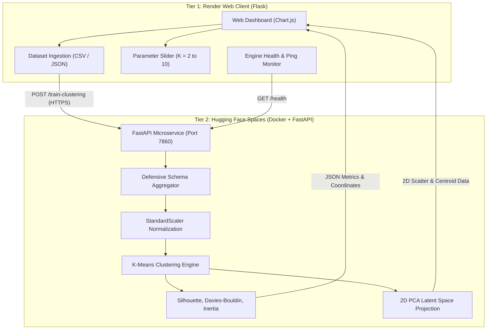

# City-Service Review Profiles for Business Pattern Segmentation Through Clustering

[](https://www.python.org/)
[](https://fastapi.tiangolo.com/)
[](https://www.docker.com/)
[](https://huggingface.co/spaces/progressmurau/city-business-clustering)
[](https://render.com/)
[](https://scikit-learn.org/)
[](https://www.chartjs.org/)
[](https://opensource.org/licenses/MIT)

---

## 📌 Project Overview

**City-Service Review Profiles for Business Pattern Segmentation** is an end-to-end machine learning system designed to discover underlying operational archetypes across metropolitan businesses from customer reviews. 

The system implements an unsupervised pipeline covering:
1. **Feature Aggregation:** Aggregating raw customer reviews into business-level behavioral profiles (rating sentiment, review count volume, rating volatility/consistency, and text length).
2. **Feature Normalization:** Standardizing multi-scale indicators using `StandardScaler`.
3. **Partition Clustering:** Applying K-Means clustering ($K=2$ to $10$) to group businesses into distinct performance clusters.
4. **Validation Metrics:** Computing Silhouette Score, Davies-Bouldin Index, and Inertia to evaluate cluster cohesion and separation.
5. **Dimensionality Reduction:** 2D Principal Component Analysis (PCA) to project high-dimensional clusters onto an interactive visual plane.

---

## 🏛 System Architecture

The project is structured as a two-tier distributed platform separating compute-heavy ML workloads from the interactive user dashboard:



### Architectural Breakdown
- **Tier 1 — Web Client & Dashboard (Render):**
  - Built with Python Flask and vanilla JavaScript.
  - Interactive visualizations powered by Chart.js 4.x (2D PCA scatter plots, cluster centroids, feature attribute bars, and market distribution charts).
  - Communicates asynchronously via persistent HTTPS with the Hugging Face microservice.
- **Tier 2 — ML Compute Microservice (Hugging Face Spaces):**
  - Containerized with Docker running on `CPU basic (2 vCPU, 16GB RAM)` on port `7860`.
  - Handles dataset ingestion, feature aggregation, clustering, and PCA dimensionality reduction.
  - 24/7 availability with no tunnel timeout limitations.

---

## 🗂 Project Structure

```text
City Service pipeline/
├── .gitignore                   # Ignores __pycache__, virtual environments, and temporary files
├── Procfile                     # Process manager file for Render web deployment
├── render.yaml                  # Render Blueprint specifying build/start commands & env vars
├── requirements.txt             # Render production web dependencies (Flask, Gunicorn, Requests)
├── Dockerfile                   # Root Docker container configuration
├── main.py                      # Root FastAPI entry point
├── app.py                       # Flask Web Server & Hugging Face API proxy
├── README.md                    # Project documentation and deployment guides
│
├── hf_space/                    # Standalone Hugging Face Space package
│   ├── Dockerfile               # Non-root UID 1000 Dockerfile for Hugging Face Spaces
│   ├── main.py                  # Full FastAPI Clustering Microservice
│   ├── requirements.txt         # ML engine dependencies (FastAPI, scikit-learn, pandas)
│   └── README.md                # Hugging Face Space YAML metadata configuration
│
├── sample_data/                 # Sample datasets for instant testing
│   ├── generate_samples.py      # Script to generate synthetic reviews
│   ├── sample_reviews.csv       # 2,710 raw reviews across 100 businesses (Case A)
│   └── sample_aggregated.csv    # 100 pre-aggregated business profiles (Case B)
│
├── templates/
│   └── index.html               # Responsive dashboard UI (HTML5, Tailwind CSS, Chart.js)
│
├── static/
│   ├── css/
│   │   └── styles.css           # Glassmorphism styling and custom controls
│   └── js/
│       └── dashboard.js         # Real-time health check, AJAX training, Chart.js logic
│
└── tests/
    ├── test_app.py              # Tests for Flask web routes and static file delivery
    ├── test_hf_worker.py        # Integration tests for Hugging Face ML microservice
    └── test_worker.py           # Verification tests for K-Means and PCA computations
```

---

## 🛠 Dependencies & Stack

### Web Client Tier (Render)
- `flask>=3.0.0`
- `requests>=2.31.0`
- `gunicorn>=21.2.0`

### ML Engine Tier (Hugging Face Spaces)
- `fastapi>=0.110.0`
- `uvicorn>=0.28.0`
- `python-multipart>=0.0.9`
- `scikit-learn>=1.4.0`
- `pandas>=2.2.0`
- `numpy>=1.26.0`

---

## 🚀 Deployment Guide

### Phase 1: Deploy ML Compute Engine to Hugging Face Spaces

1. Create a new Space on [Hugging Face Spaces](https://huggingface.co/new-space):
   - **Space Name:** `city-business-clustering`
   - **License:** `mit`
   - **SDK:** `Docker` $\rightarrow$ `Blank`
   - **Hardware:** `CPU basic (2 vCPU, 16GB RAM)`
2. Push the files to your Hugging Face Space:
   ```bash
   git remote add hf https://huggingface.co/spaces/progressmurau/city-business-clustering
   git push hf main
   ```
   *(Or upload the 4 files from `hf_space/` directly in the Hugging Face web interface: `Dockerfile`, `main.py`, `requirements.txt`, and `README.md`).*
3. Test your live endpoint:
   ```bash
   curl https://progressmurau-city-business-clustering.static.hf.space/health
   ```
   *Expected Response:*
   ```json
   {"status": "online", "worker": "hf-spaces-ml-engine"}
   ```

---

### Phase 2: Deploy Web Dashboard to Render

1. Create a new repository on [GitHub](https://github.com/new) (e.g. `city-service-clustering`) and push your code:
   ```bash
   git branch -M main
   git remote add origin https://github.com/<YOUR_GITHUB_USERNAME>/<YOUR_REPO_NAME>.git
   git push -u origin main
   ```
2. In the [Render Dashboard](https://dashboard.render.com), click **New +** $\rightarrow$ **Web Service**.
3. Connect your GitHub repository.
4. Set the build settings:
   - **Name:** `city-service-clustering-dashboard`
   - **Runtime:** `Python 3`
   - **Build Command:** `pip install -r requirements.txt`
   - **Start Command:** `gunicorn app:app --bind 0.0.0.0:$PORT --workers 2 --timeout 120`
5. Under **Environment Variables**, add:
   - `HF_WORKER_URL` = `https://progressmurau-city-business-clustering.static.hf.space`
   - `FLASK_ENV` = `production`
6. Click **Create Web Service**.

---

## 💻 Local Development & Testing

You can run both tiers locally on your machine:

```bash
# Terminal 1: Start Hugging Face ML Microservice
uvicorn hf_space.main:app --host 0.0.0.0 --port 7860

# Terminal 2: Start Flask Web Dashboard
set HF_WORKER_URL=http://localhost:7860
python app.py
```

Navigate to `http://localhost:5000` in your web browser. Click **"Load Sample Reviews (Case A)"** to execute clustering and inspect the results.

### Running Automated Test Suites
```bash
# Verify ML Engine endpoints and schema detection
python test_hf_worker.py

# Verify Flask routes and sample dataset downloads
python test_app.py
```

---

## 📊 Business Pattern Archetype Classification

The platform classifies clusters into distinct operational patterns using centroid heuristics:

| Archetype Pattern | Characteristics | Interpretation & Strategic Action |
|---|---|---|
| **High-Volume Champions** | High ratings, strong review volume | High brand equity and consistent customer satisfaction. Market leaders and benchmarks. |
| **Polarized / Volatile Services** | High rating standard deviation (variance) | Mixed sentiment. Indicates inconsistent service delivery; requires quality control standardization. |
| **Emerging Boutique Niches** | High ratings, low review volume | Newly established or niche providers with high satisfaction. Priority candidates for review-generation campaigns. |
| **At-Risk Providers** | Low average ratings | Persistent customer complaints. Urgent managerial intervention and service recovery needed. |
| **Consistent Mid-Tier** | Average ratings, low variance | Dependable, standard performance. Opportunities exist to elevate customer delight. |

---

## 📜 License

This project is licensed under the MIT License.
